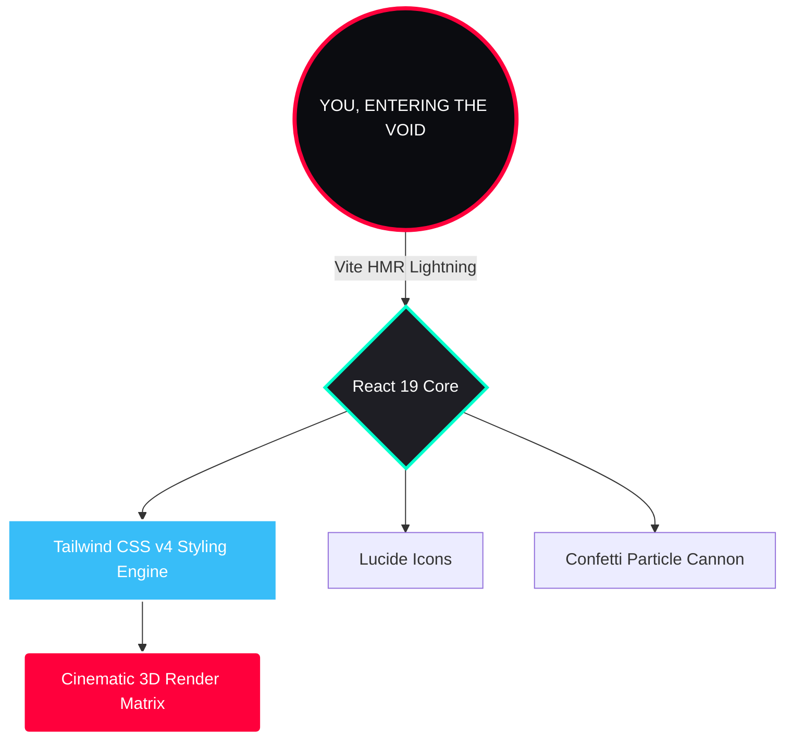

# 🤯🔥 WATCH-OR-SKIP: THE ULTIMATE CINEMATIC ARCHIVE 🔥🤯

> **WARNING:** This is not your average, boring grid-layout streaming menu. This is a **VIRTUAL, TACTILE, 3D REVOLUTION**. 🍿🚀

Welcome to the void (`#0b0c10`). Welcome to **WatchOrSkip** (a.k.a. *a24-disc-experience*)! We took 79 of the absolute **GREATEST** masterworks in human history—mind-bending Sci-Fi, Hollywood royalty, legendary Indian cinema, and modern masterpieces—and shoved them into an insanely interactive, physics-defying 3D disc library. 

Spin them. Flip them. Let the confetti drop. 📀✨

---

## ⚡ WHAT MAKES IT SO CRAZY?! ⚡

- 💿 **GOD-TIER 3D INTERACTIVITY:** We didn't just list movies; we built a *physical archive in your browser*. 
- 💅 **A24 AESTHETICS ON STEROIDS:** Deep blacks, crisp contrasts, and typography so good it belongs in a museum. 
- 🎉 **CONFETTI EXPLOSIONS:** Powered by `canvas-confetti` because every great movie choice deserves a celebration.
- 🚀 **WARP-SPEED PERFORMANCE:** React 19 + Vite = UI that updates before you even finish clicking.
- 🪟 **CINEMATIC GLASS SHELL:** A responsive glassmorphism archive with primary horizontal navigation, a complementary desktop rail, and compact mobile controls for Discover, Movies, Genres, and Search.
- 🎞️ **FEATURED MOVIE HERO:** A wide, responsive lead card follows the active archive film, using its existing poster and verified catalog metadata, rating-based WATCH / MAYBE / SKIP, details, trailer, and a device-local watchlist action.
- 🎬 **SMART WATCH OR SKIP:** Describe your mood, a reference film, or a runtime limit and get an explainable WATCH / MAYBE / SKIP recommendation from the archive.

The Smart Watch Or Skip matcher runs locally against the archive's genres, synopses, and runtimes. Your prompt is not sent to a third-party service. The featured hero follows the archive's selected film and opens its existing detail and trailer views; watchlist IDs are stored in the browser's local storage. The glass shell uses separate smoky window, readable panel, card, navigation, and control materials. Backdrop blur is reserved for standalone surfaces rather than repeated on every movie card, with solid fallbacks for browsers without filter support and reduced-transparency preferences.

---

## 💬 UNHINGED COMMUNITY CHATS 💬

> 👾 **Hackerman_99:** "Bro my GPU is crying but my eyes are in heaven! This UI is INSANE."
> 
> 🎥 **Tarantino_Fan_42:** "The A24-style typography is literal chef's kiss. It feels like a premium physical collection that I can actually touch."
>
> 🍿 **BingeWatcher_X:** "Skip or watch?! I CAN'T DECIDE, THE DISCS ARE TOO FUN TO SPIN! 😵‍💫"
>
> 💻 **DevGod:** "React 19 + Tailwind v4 + 3D rendering? The source code must be beautiful. This stack is goated. 🐐"

---

## 📊 THE BRAINS BEHIND THE BEAUTY (Architecture)



---

## 💻 HACK IN & INSTALL (Dev Setup)

Ready to run this beast locally? Open your terminal and cast these spells:

1. **Clone the archive:**
   ```bash
   git clone https://github.com/yourusername/a24-disc-experience.git
   cd a24-disc-experience
   ```

2. **Summon the dependencies:**
   ```bash
   npm install
   ```

3. **Ignite the server:**
   ```bash
   npm run dev
   ```

4. **Forge the production build:**
   ```bash
   npm run build
   ```

## Deploy to GitHub Pages

This project is configured for the repository URL `/Watch_Or_Skip/`. In the GitHub repository, open **Settings → Pages** and set the build and deployment source to **GitHub Actions**. Push to `main` (or run the workflow manually from the Actions tab); the workflow builds the site and deploys the generated `dist` directory.

---

## 🖋️ THE SACRED TYPOGRAPHY STACK
To get that flawless, cinematic editorial look, we invoked the ancient Google Fonts:
- 🏛️ **Cinzel** - Dramatic, monumental, epic titles.
- 🎭 **Syne & Playfair Display** - Expressive, gorgeous sub-headings.
- 📖 **Plus Jakarta Sans** - Crisp, ultra-readable body text.
- 📟 **JetBrains Mono** - For the hardcore technical data and runtimes.

---
*Coded with blood, sweat, and 🍿 for the absolute love of cinema.*
